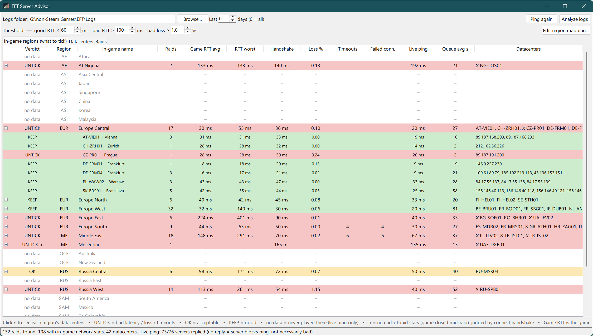
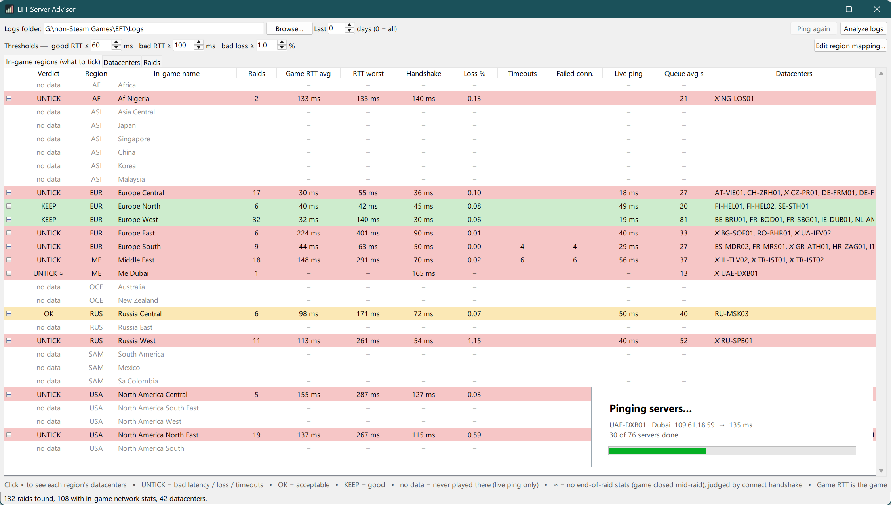

# Tarkov Server Advisor

**This tool reads your Escape from Tarkov logs. It shows which matchmaking regions cause bad raids.**

In Escape from Tarkov, you select matchmaking regions in the *Configure game servers list for matching* dialog.
The menu shows only one ping value for each region. Tarkov Server Advisor gives you more data:

1. It reads your game logs.
2. It finds each raid server that you played on.
3. It collects the network data that the game recorded for each raid.
4. It pings these servers now.
5. It tells you which regions to **keep** and which regions to **untick**.



## Download

1. Download **`EFT-Server-Advisor.exe`** from the [latest release](https://github.com/digitalfrost84/tarkov-server-advisor/releases/latest).
2. Run the file. You do not have to install the tool. You do not have to install Python.

The tool uses the Windows registry to find your EFT installation and its `Logs` folder.
If the tool cannot find the folder, click **Browse…** and select it.
The `Logs` folder is in your game installation folder.

> **Note:** The .exe file does not have a code signature.
> Thus, Windows SmartScreen can show a warning about an unknown publisher.
> To continue, click **More info → Run anyway**.
> You can also [run the tool from source](#run-from-source).

## What the tool shows

When the tool starts, it scans your logs. Then it pings the servers that you played on.
The tool shows one row for each in-game region.
The rows are in the same sequence as in the server dialog of the game.

| Verdict | Meaning |
|---|---|
| 🟥 **UNTICK** | Your raids had high latency, packet loss or connection timeouts. |
| 🟨 **OK** | You can play, but the connection is not good. |
| 🟩 **KEEP** | The latency is good. There are no problems. |
| ⬜ **no data** | The game did not match you to this region. |

To see each **datacenter** in a region, click ⊞ on the region.
For example, Europe Central contains Frankfurt, Vienna, Prague and other datacenters.

In the game, you can untick only full regions. Thus, **the worst datacenter sets the verdict for its region**.
The tool marks the bad datacenters with ✗.

The table has these columns for each region and datacenter:

- **Raids:** The number of raids that you played there.
- **Game RTT avg / worst:** The round-trip time that the game measured during the raid.
- **Handshake:** The time that the connection to the raid server took.
- **Loss %:** The packet loss. The tool weights this value by traffic. Thus, one short raid cannot change the average too much.
- **Timeouts / Failed conn.:** The number of lost connections and failed connections.
- **Live ping:** The ping to these servers now. Some servers block ping. For these servers, the tool shows `–`.
- **Queue avg s:** The average matchmaking time before the raid, in seconds.

The **Datacenters** tab shows the same data for each datacenter.
The **Raids** tab shows the same data for each raid.



### Settings

- **Thresholds:** Set the limits for good RTT, bad RTT and bad loss.
  The default values are 60 ms, 100 ms and 1 %. The table changes immediately when you type a value.
- **Last N days:** Use only the raids from the last N days. Set 0 to use all raids.
  The change occurs immediately. Use this setting after BSG moves servers.
- **Edit region mapping…:** Change the in-game region of a datacenter. Refer to [Region mapping](#region-mapping).

## How the tool works

All data comes from log files that the game writes. The tool does not interact with the game process.

| Data | Source |
|---|---|
| Server IP, map, server ID | `application` log. The `profileStatus` line, which the game writes when a raid starts. |
| Game RTT, packet loss | `network-connection` log. The `Statistics (…)` line, which the game writes when a raid ends. |
| Handshake time | `network-connection` log. The time from *Send connect* to *Connected*. |
| Timeouts | `network-connection` log. In older logs, the `errors` log. |
| Queue time | `application` log. The `MatchingCompleted` line. |

If the game closed before the end of a raid, the log has no end-of-raid data for that raid.
In this condition, the tool uses the handshake time to find the verdict.
The tool marks this raid with **≈**.

### Region mapping

Each server ID in the logs starts with a country code and a city code. For example:

- `FR-SBG01…` is Strasbourg, France.
- `CZ-PR01…` is Prague, Czech Republic.

**The logs do not show the in-game region of a city.** BSG does not publish this data.
Thus, the tool uses a built-in table of estimates.
For some cities, the region is clear. For example, Lagos is in Af Nigeria and Dubai is in Me Dubai.
For countries near a region border, the region is an estimate. Examples are Poland, Croatia and Serbia.

If a datacenter is in the wrong region, do these steps:

1. Click **Edit region mapping…**.
   The tool creates the file `%APPDATA%\EFT Server Advisor\region_map.json`.
2. In this file, add an entry for each datacenter that you want to change. For example:

   ```json
   { "CZ-PR": "Europe East", "HR": "Europe South" }
   ```

- Each key is `CC-CITY` (one city) or `CC` (all cities in one country).
- Each value must be the same as an in-game region name.

To make sure that the mapping is correct, do these steps:

1. In the game, tick only one region.
2. Play some raids.
3. In the tool, click **Analyze logs**.

All datacenters that the tool shows are in that region.

### Game RTT and live ping

Game RTT is usually higher than live ping. Game RTT includes the processing time of the raid server.
Compare the regions with each other. Do not compare them with the ping in the game menu.

## Run from source

You must have Python 3.10 or later on Windows.
The tool uses only the standard library. You do not have to install packages.

```bash
python eft_server_advisor.py
```

To run the tool without a console window, double-click `EFT Server Advisor.bat`.

### Build the .exe file

```bash
pip install pyinstaller
pyinstaller --noconfirm "build_assets/EFT Server Advisor.spec"
```

The output file is `dist/EFT Server Advisor.exe`.

## Privacy

- The tool reads only your local EFT log files.
- The tool does not send data. The only network traffic is ping (ICMP) to game servers that you played on.
- The tool has no accounts, no telemetry and no update checks.

## Disclaimer

This is an unofficial fan tool. Battlestate Games does not endorse it, and the tool has no connection to Battlestate Games.
Escape from Tarkov is a trademark of Battlestate Games Limited.
